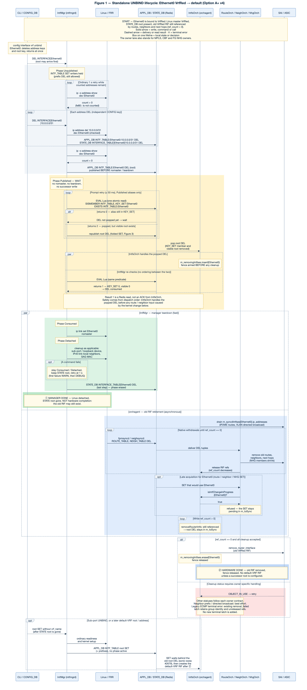
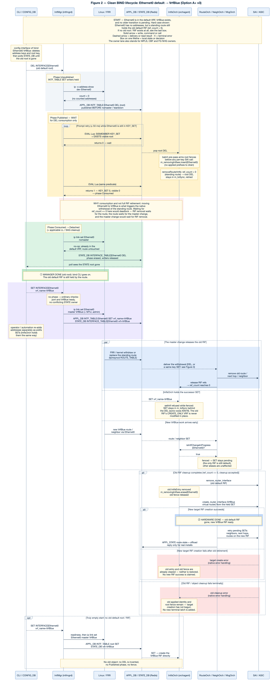
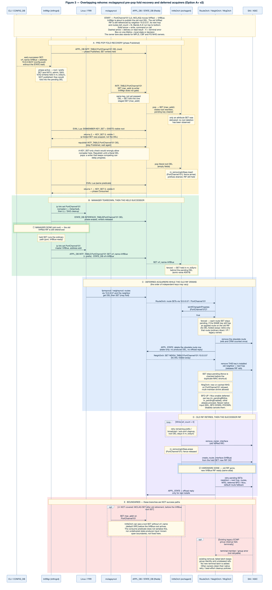

# SONiC VRF Bind Guard High-Level Design

## Revision history

| Rev | Date       | Author     | Change Description |
| --- | ---------- | ---------- | ------------------ |
| 0.1 | 2026-09-28 | Bojun-Feng | Initial draft. Describes the VRF bind guard and interface retirement approach. |
| 0.2 | 2026-10-28 | Bojun-Feng | Rewrite for readability and structure; add table of contents, definitions, and schema example. |
| 0.3 | 2026-10-30 | Bojun-Feng | Update following Routing WG review: replace custom Redis guard tables/channels with native `APPL_DB` `INTF_TABLE` root-delete consumption ordering in `IntfMgr` and root-scoped removal fencing across `orchagent` dependency owners. |
| 0.4 | 2026-10-31 | Part 7 review | Resolve Round-1 C1–C5 and documentation findings; distinguish async consumption, cleanup and creation boundaries. |
| 0.5 | 2026-10-31 | Part 8 review | Preserve SAG disable publication across retries, restore SAG after GLOBAL recreation, retire ordinary routes with cached-down replacements, and replay fenced Mux ACTIVE acquisitions with exact local next-hop ownership. |
| 0.6 | 2026-10-31 | Part 9 review | Record Mux local reference ownership at acquisition/release, re-arm unfinished ACTIVE work after a newer neighbor SET, avoid incomplete-neighbor iterator reuse, and separate requested SAG configuration from applied shared-route membership. |
| 0.7 | 2026-10-31 | Part 10 review | Preserve local reference ownership before late Mux mapping, retain requested SAG across partial APP root updates, and exclude prefix-cleanup retries from complete-neighbor notification snapshots. |

## Table of contents

- [Revision history](#revision-history)
- [Definitions and abbreviations](#definitions-and-abbreviations)
- [1. Background and problem statement](#1-background-and-problem-statement)
  - [1.1 End-to-end VRF rehome flow and SAI constraints](#11-end-to-end-vrf-rehome-flow-and-sai-constraints)
  - [1.2 Observed-removal race window (#27608, #29919)](#12-observed-removal-race-window-27608-29919)
  - [1.3 Pre-observation and pre-pop coalescing window (#28619, #4924)](#13-pre-observation-and-pre-pop-coalescing-window-28619-4924)
- [2. Design principles and evaluated alternatives](#2-design-principles-and-evaluated-alternatives)
  - [2.1 Requiring route VRF to match outgoing RIF VRF](#21-requiring-route-vrf-to-match-outgoing-rif-vrf)
  - [2.2 Post-hoc healing and global owner eviction](#22-post-hoc-healing-and-global-owner-eviction)
  - [2.3 Waiting for full SAI RIF retirement before kernel VRF changes](#23-waiting-for-full-sai-rif-retirement-before-kernel-vrf-changes)
  - [2.4 Reordering APPL_DB publication without waiting for consumption](#24-reordering-appl_db-publication-without-waiting-for-consumption)
- [3. Architecture and coordination overview](#3-architecture-and-coordination-overview)
  - [3.1 Core ordering rules and completion boundaries](#31-core-ordering-rules-and-completion-boundaries)
  - [3.2 Existing Redis and local state contracts](#32-existing-redis-and-local-state-contracts)
- [4. Producer design in IntfMgr (intfmgrd)](#4-producer-design-in-intfmgr-intfmgrd)
  - [4.1 Four-phase root deletion state machine](#41-four-phase-root-deletion-state-machine)
  - [4.2 Atomic Lua consumption check and MCLAG pre-pop repair](#42-atomic-lua-consumption-check-and-mclag-pre-pop-repair)
  - [4.3 Closing the manager writer window](#43-closing-the-manager-writer-window)
  - [4.4 SAG disable, link-local ordering, and prefix failure handling](#44-sag-disable-link-local-ordering-and-prefix-failure-handling)
  - [4.5 Targeted 50 ms polling and rate-limited failure logging](#45-targeted-50-ms-polling-and-rate-limited-failure-logging)
- [5. Consumer and dependency owner design in orchagent](#5-consumer-and-dependency-owner-design-in-orchagent)
  - [5.1 IntfsOrch and PortsOrch: root-owned fence, prefix drain, and subports](#51-intfsorch-and-portsorch-root-owned-fence-prefix-drain-and-subports)
  - [5.2 NeighOrch: neighbor admission, same-key fold, BFD, and Dual-ToR Mux](#52-neighorch-neighbor-admission-same-key-fold-bfd-and-dual-tor-mux)
  - [5.3 RouteOrch (IP and MPLS), NhgOrch, CbfNhgOrch, and FgNhgOrch](#53-routeorch-ip-and-mpls-nhgorch-cbfnhgorch-and-fgnhgorch)
- [6. End-to-end lifecycle flows](#6-end-to-end-lifecycle-flows)
  - [6.1 UNBIND / Named-to-default lifecycle](#61-unbind--named-to-default-lifecycle)
  - [6.2 Clean BIND / Default-to-named lifecycle](#62-clean-bind--default-to-named-lifecycle)
  - [6.3 Overlapping rehome / MCLAG pre-pop fold and deferred acquirers](#63-overlapping-rehome--mclag-pre-pop-fold-and-deferred-acquirers)
- [7. Warm reboot, fast reboot, scale, and operational impact](#7-warm-reboot-fast-reboot-scale-and-operational-impact)
  - [7.1 Reboot and process restart semantics](#71-reboot-and-process-restart-semantics)
  - [7.2 Memory, algorithmic complexity, and scale](#72-memory-algorithmic-complexity-and-scale)
  - [7.3 Operator diagnosis by stalled boundary](#73-operator-diagnosis-by-stalled-boundary)
- [8. Scope boundaries and limitations](#8-scope-boundaries-and-limitations)
- [9. Testing and validation plan](#9-testing-and-validation-plan)
  - [9.1 Unit and component validation](#91-unit-and-component-validation)
  - [9.2 System and hardware acceptance matrix](#92-system-and-hardware-acceptance-matrix)
- [10. References](#10-references)

## Definitions and abbreviations

| Term | Definition |
| --- | --- |
| `VRF` | Virtual Routing and Forwarding instance, represented in Linux as a master network device and in SAI as a virtual router object (`sai_virtual_router_id`). |
| `RIF` | Switch Abstraction Interface (SAI) router interface object (`sai_router_interface_id`) managed by `IntfsOrch`. |
| `Root interface key` | Interface-level key in `CONFIG_DB` (`INTERFACE\|<alias>`) or `APPL_DB` (`INTF_TABLE:<alias>`) carrying interface attributes such as `vrf_name`, `mtu`, `admin_status`, and `mac_addr`. |
| `Prefix key` | Address-level key in `CONFIG_DB` (`INTERFACE\|<alias>\|<prefix>`) or `APPL_DB` (`INTF_TABLE:<alias>:<prefix>`) carrying an IPv4 or IPv6 subnet assignment. |
| `APPL_DB` `INTF_TABLE_KEY_SET` | Internal `ProducerStateTable` Redis set holding `INTF_TABLE` keys that have staged updates waiting to be popped by `orchagent`. |
| `STATE_DB` `INTERFACE_TABLE` | State database table holding `IntfMgr`'s recorded interface state (`INTERFACE_TABLE\|<alias>`) and recorded address state (`INTERFACE_TABLE\|<alias>\|<prefix>`). |
| `m_pendingIntfDeletes` | `IntfMgr` runtime per-alias deletion state map (`Unpublished`, `Published`, `Consumed`, `Detached`) coordinating producer-side root deletion ordering. |
| `m_removingIntfses` | `IntfsOrch` runtime set of interface aliases undergoing root deletion, consulted via `isIntfChangeInProgress(alias)` to block new object acquisition on retiring RIFs. |
| `Dependency owners` | `orchagent` modules that create, cache, reuse, or withdraw SAI objects referencing an interface's RIF (`RouteOrch` (IP and MPLS), `NeighOrch`, `NhgOrch`, `CbfNhgOrch`, and `FgNhgOrch`). |

## 1. Background and problem statement

### 1.1 End-to-end VRF rehome flow and SAI constraints

When an operator rehomes a SONiC L3 interface (physical port, PortChannel, VLAN, or sub-interface) between VRFs using `config interface vrf bind` or `config interface vrf unbind`, the configuration change traverses multiple asynchronous processes:

1. **CLI and `CONFIG_DB`:** The `config` CLI removes configured IP addresses and the existing interface root entry in `CONFIG_DB`, waits for `IntfMgr` to remove the recorded interface entry (`STATE_DB` `INTERFACE_TABLE|<alias>`), and (for `bind`) writes the new interface root entry with `vrf_name: <TargetVrf>` and warns that addresses were removed. Re-adding addresses is a separate operator or automation action; the bind command does not restore them.
2. **`IntfMgr` (`intfmgrd`):** Consumes `CONFIG_DB` interface tables, executes `ip` commands to remove/add IP addresses and change the Linux netdev VRF master (`ip link set <alias> nomaster` or `master <TargetVrf>`), publishes interface root and prefix updates to `APPL_DB` `INTF_TABLE`, and records interface readiness in `STATE_DB` `INTERFACE_TABLE`.
3. **Linux kernel, FRR (`zebra` -> `fpmsyncd`), and `neighsyncd`:** Kernel netdev VRF changes and IP address updates immediately trigger kernel netlink notifications. FRR's `zebra` updates connected and protocol routes and streams them via FPM to `fpmsyncd`, which writes `APPL_DB` `ROUTE_TABLE` and `NEXTHOP_GROUP_TABLE`. Concurrently, `neighsyncd` writes kernel neighbor updates to `APPL_DB` `NEIGH_TABLE`.
4. **`orchagent` (`IntfsOrch`, `RouteOrch`, `NeighOrch`, `NhgOrch`):** Consumes `APPL_DB` tables independently and programs SAI objects in the ASIC via `syncd`.

In SAI, a router interface's virtual router attribute (`SAI_ROUTER_INTERFACE_ATTR_VIRTUAL_ROUTER_ID`) is defined with flags `MANDATORY_ON_CREATE | CREATE_ONLY`. An existing SAI RIF cannot be moved in place to a different virtual router. Instead, `IntfsOrch` must completely remove the old SAI RIF—which requires its software and hardware reference count (`ref_count`) to reach `0` after all attached prefixes, neighbors, next hops, and routes are removed—before creating a new SAI RIF bound to the new virtual router OID.

Because Linux kernel mutations inside `IntfMgr` execute synchronously in milliseconds while `orchagent` drains `APPL_DB` tables asynchronously across independent consumers and waits for dependent SAI objects to release references, the Linux interface can enter the new VRF while `IntfsOrch` still owns the old RIF. This speed mismatch creates two distinct race windows.

### 1.2 Observed-removal race window (#27608, #29919)

In the **observed-removal window**, `IntfsOrch` has already popped the root `INTF_TABLE:<alias>` `DEL` from `APPL_DB`, begun trying to retire the old RIF, and added `<alias>` to `m_removingIntfses` (`isIntfChangeInProgress(alias) == true`). However, old references still hold `ref_count > 0`, keeping the old RIF alive in `m_syncdIntfses[alias]`. While the old RIF waits for retirement:

- **Connected route attachment (`#27608`):** Prior to `sonic-swss#4645`, when the interface was quickly rebound to `Vrf01` and assigned an IP address, `RouteOrch` received the new connected route for `Vrf01`, resolved `<alias>` to the still-present old RIF (owned by the default VRF), and programmed the `Vrf01` route against the default-VRF RIF. Traffic ingressing the interface was looked up in the default VRF and blackholed, while the new route's reference permanently pinned the old RIF.
- **Neighbor, next-hop, and group attachment (`#29919`):** Even after `#4645` deferred connected routes while `isIntfChangeInProgress(alias)` is true, `NeighOrch` (`addNeighbor`, `addNextHop`), `RouteOrch` (ordinary gateway routes, legacy ECMP groups, MPLS label routes), `NhgOrch`, `CbfNhgOrch`, and `FgNhgOrch` lacked comprehensive admission and cached-reuse checks. In `#29919`, while a connected route waited for `PortChannel101` retirement, an ordinary IP route through `10.0.0.57` caused `NeighOrch` to create a neighbor (`ref_count + 1`) and next hop (`ref_count + 1`) on the retiring RIF, wedging the old RIF at `ref_count == 2`.
- **Premature fence clearing on prefix `DEL`:** Previously, `IntfsOrch` cleared `m_removingIntfses` whenever `removeIntf` returned `true`, including after an individual prefix `DEL` (`INTF_TABLE:<alias>:<prefix>`) while the root still had outstanding references, disarming the fence before the root interface `DEL` completed.

### 1.3 Pre-observation and pre-pop coalescing window (#28619, #4924)

In the **pre-observation and pre-pop coalescing window**, `IntfsOrch` has not yet observed the root `DEL` when new VRF routes or neighbors arrive:

- **Kernel detachment before `APPL_DB` publication (`#28619`):** In existing `IntfMgr::doIntfGeneralTask`, `IntfMgr` executed `ip link set <alias> nomaster` and link-local neighbor cleanup *before* publishing `m_appIntfTableProducer.del(alias)`, and immediately deleted `STATE_DB` `INTERFACE_TABLE|<alias>`. That allowed `config interface vrf bind` to immediately move the Linux interface into the target VRF and trigger `fpmsyncd`/`neighsyncd` updates before `IntfsOrch` ever saw the root `DEL`. When `RouteOrch` was scheduled before `IntfsOrch`, `isIntfChangeInProgress(alias)` was still `false`, so `RouteOrch` bound the new route to the old RIF without queuing it for retry.
- **Pre-pop `DEL`+`SET` coalescing in `ProducerStateTable` (`#4924`):** `SWSS-common`'s `ProducerStateTable` coalesces staged operations per key in Redis before `ConsumerStateTable::pops` drains them. If `IntfMgr` publishes a root `DEL` and then publishes the new VRF's root `SET` before `orchagent` pops `INTF_TABLE_KEY_SET`—or if a competing producer such as `mclagsyncd` publishes a partial MAC-only `SET` on `<alias>` while the `DEL` is still pending in `INTF_TABLE_KEY_SET`—the consumer Lua script folds the staged `DEL` and `SET` into a single `SET` tuple. `IntfsOrch` never receives the root `DEL`, attempts to apply the new VRF via a `SET` on the existing RIF, and fails because `SAI_ROUTER_INTERFACE_ATTR_VIRTUAL_ROUTER_ID` is `CREATE_ONLY`.

## 2. Design principles and evaluated alternatives

### 2.1 Requiring route VRF to match outgoing RIF VRF

A tempting one-line check is to reject any route in `RouteOrch` whose route-table VRF (`vrf_id`) differs from the outgoing RIF's VRF (`IntfsOrch::getRouterIntfsVrf(alias)`). This approach fails for two reasons:

1. **Breaks legitimate cross-VRF forwarding:** Steady-state VRF route leaking (static or BGP leaked routes) and EVPN/VPN decapsulation legitimately install a route in lookup VRF `A` whose outgoing next hop or RIF belongs to VRF `B` (as noted in `sonic-swss#4645` review).
2. **Incomplete VRF metadata across producers:** SONiC's FRR patch (`0003-SONiC-ONLY-nexthops-compare-vrf-only-if-ip-type.patch`) omits `vrf_id` comparison on `IFINDEX`-only nexthops, and `APPL_DB` `NEIGH_TABLE` entries carry no VRF field at all.

Therefore, admission must check **lifecycle state** (whether `<alias>` is currently retiring its old RIF), not VRF equality.

### 2.2 Post-hoc healing and global owner eviction

Another alternative is allowing `IntfMgr` and `orchagent` consumers to race freely, and having `IntfsOrch` forcibly evict all routes, next-hop groups, and neighbors referencing `<alias>` whenever a VRF change is detected, storing a shadow mirror of desired configurations across `Orch` modules for later replay. This approach was rejected because:

1. Forcibly tearing down and replaying active routes across all tables introduces transient cross-VRF packet forwarding leaks during the window before `IntfsOrch` runs.
2. Synthetically deleting and recreating routes inside `orchagent` without native producer updates violates `fpmsyncd` `suppress-fib-pending` (`APPL_STATE_DB`) acknowledgment semantics.
3. Maintaining shadow desired-state mirrors duplicates `ConsumerBase::m_toSync` across route, label, neighbor, and group owners.

### 2.3 Waiting for full SAI RIF retirement before kernel VRF changes

For top-level VRF deletion (`sonic-swss#943`), `vrfmgrd` waits for `orchagent` to delete the SAI virtual router before deleting the Linux VRF device. However, applying that rule literally to interface VRF rehoming—blocking all Linux VRF binding changes until the old SAI RIF is completely deleted in hardware—creates a **circular deadlock** on `default -> named VRF` transitions:

1. Suppose an addressless interface (`Ethernet0`) in the default VRF has a standing static or BGP interface route holding a reference on `Ethernet0`'s default-VRF RIF.
2. During the unbind phase of `default -> VrfBlue`, `ip link set Ethernet0 nomaster` on an interface already in the default VRF is a kernel no-op: the interface does not cycle and FRR does not withdraw the standing route.
3. FRR will only withdraw that standing route when `IntfMgr` executes `ip link set Ethernet0 master VrfBlue`.
4. If `IntfMgr` blocks `master VrfBlue` until the old RIF's `ref_count` reaches `0`, `IntfsOrch` waits for FRR to withdraw the route while FRR waits for `IntfMgr` to execute `master VrfBlue`.

Consequently, `IntfMgr` must wait for `IntfsOrch` to **consume** the root `DEL` (arming the admission fence so no *new* references can attach to the old RIF), and then proceed with the Linux kernel transition so FRR and `neighsyncd` naturally emit withdrawals that drain the old RIF's existing references.

### 2.4 Reordering APPL_DB publication without waiting for consumption

Simply moving `m_appIntfTableProducer.del(alias)` ahead of `ip link set <alias> nomaster` inside `IntfMgr` without waiting for `orchagent` to pop the `DEL` is also insufficient:

1. **Equal `Select` priorities in `orchagent`:** Although `IntfsOrch`, `NeighOrch`, and `RouteOrch` pass internal priority constants `35`, `30`, and `5` when constructing their `Consumer` objects, `Orch` registers `Executor` wrappers with `Select`, and `Executor` inherits `Selectable::getPri()` returning `0` without delegating to the wrapped consumer. Thus all `APPL_DB` consumers run at effective priority `0`, and `RouteOrch` or `NeighOrch` can still be serviced before `IntfsOrch` pops the root `DEL`.
2. **Pre-pop coalescing (`#4924`):** Without waiting for `orchagent` to pop the root `DEL`, a subsequent `SET` from `IntfMgr` (or a partial `SET` from `mclagsyncd`) can still fold with the unpopped `DEL` inside `ProducerStateTable`.

## 3. Architecture and coordination overview

### 3.1 Core ordering rules and completion boundaries

Following Routing WG review, this design eliminates custom cross-process guard tables (`STATE_DB` `INTERFACE_GUARD_TABLE`, `APPL_DB` `INTF_GUARD_TABLE`, and `INTF_GUARD_ACK`) and instead coordinates VRF transitions using **existing `APPL_DB` `INTF_TABLE` transport, `STATE_DB` `INTERFACE_TABLE`, and process-local state machines**:

1. **Publish and consume root `DEL` before kernel detach:** During root interface removal, `IntfMgr` blocks all successor `APPL_DB` writes for `<alias>`, publishes the ordinary `APPL_DB` `INTF_TABLE:<alias>` `DEL`, and waits until an atomic Lua check confirms the root `DEL` has been popped by `orchagent` (and not overwritten by a competing pre-pop `SET`) before executing `ip link set <alias> nomaster`, link-local neighbor cleanup, or `STATE_DB` `INTERFACE_TABLE|<alias>` removal.
2. **Causal dispatch arms the admission fence before successor events arrive:** In `orchagent`'s single-threaded dispatch loop (and ordered consumer ring handoff), popping the `INTF_TABLE` batch dispatches `IntfsOrch::doTask`, whose initial pre-pass arms every applied ordinary root `DEL` in that batch before any per-key parsing or SAI operation can throw. Applied loopback roots are also pre-armed for their IP2ME drain. This inserts `<alias>` into `m_removingIntfses` before any causally later route or neighbor events generated by `IntfMgr`'s subsequent kernel `nomaster`/`master` operations can be observed.
3. **Root-scoped fence blocks new acquisitions while existing references drain:** While `<alias>` is in `m_removingIntfses`, dependency owners refuse new object creation and cached object reuse referencing `<alias>`, keeping desired `SET` tasks queued in their native `ConsumerBase::m_toSync` maps. Withdrawal (`DEL`) paths, safe multi-member group shrinks, and supported same-key route/neighbor replacements remain permitted so old references can drain to zero.
4. **Old RIF retirement precedes new RIF creation:** Once all old prefixes and dependent references drain and the old SAI RIF is removed, `IntfsOrch` erases `<alias>` from `m_removingIntfses`. Any pending target `INTF_TABLE:<alias>` `SET` and deferred dependency `SET` tasks then execute on subsequent retry passes to create and populate the new RIF.

Throughout this lifecycle, completion points remain distinct:
- **CLI completion** means `CONFIG_DB` updates were written (and, for `bind`, old `STATE_DB` `INTERFACE_TABLE|<alias>` disappeared).
- **`APPL_DB` root `DEL` consumed** means `orchagent` popped the root `DEL` and armed `m_removingIntfses`, permitting `IntfMgr` to mutate the Linux kernel.
- **Old `STATE_DB` root deleted** means `IntfMgr` completed its Linux teardown; it does *not* mean the old SAI RIF has been deleted in hardware.
- **Old RIF retired** means `IntfsOrch` drained applied prefixes, `ref_count` reached `0`, `removeRouterIntfs` succeeded, and `m_removingIntfses` was cleared.

### 3.2 Existing Redis and local state contracts

No new Redis tables, fields, notification channels, YANG models, or CLI flags are introduced. The coordination relies on the following existing Redis keys and local C++ state structures:

| Key / State Structure | Owner | Scope & Persistence | Lifecycle Role |
| --- | --- | --- | --- |
| `CONFIG_DB` `INTERFACE\|<alias>`, `PORTCHANNEL_INTERFACE\|<alias>`, `VLAN_INTERFACE\|<alias>`, `VLAN_SUB_INTERFACE\|<alias>` | CLI / config producer -> `IntfMgr` | Persistent config | Supplies desired root interface (`<alias>`) and IP prefix (`<alias>\|<prefix>`) `SET`/`DEL` operations. |
| `APPL_DB` `INTF_TABLE_KEY_SET` | `ProducerStateTable` / `ConsumerStateTable` | Redis set (`APPL_DB`) | Tracks keys with unpopped staged work. Atomic Lua check inspects `SISMEMBER INTF_TABLE_KEY_SET <alias>`. |
| `APPL_DB` `INTF_TABLE:<alias>` | `IntfMgr` (and `mclagsyncd`) -> `IntfsOrch` | Redis hash (`APPL_DB`) | Visible consumed root entry. Atomic Lua check inspects `EXISTS INTF_TABLE:<alias>` to detect pre-pop `SET` folding (`#4924`). |
| `APPL_DB` `INTF_TABLE:<alias>:<prefix>` | `IntfMgr` -> `IntfsOrch` | Redis hash (`APPL_DB`) | Carries prefix additions/removals. Prefix `DEL` is allowed while root delete is pending, but never clears `m_removingIntfses`. |
| `STATE_DB` `INTERFACE_TABLE\|<alias>` | `IntfMgr` | Redis hash (`STATE_DB`) | Recorded manager interface state. Deleted *last* in `Detached` phase after consumption and Linux teardown complete. |
| `STATE_DB` `INTERFACE_TABLE\|<alias>\|<prefix>` | `IntfMgr` | Redis hash (`STATE_DB`) | Recorded manager address state. Retained if kernel address removal fails so root deletion stays in `Unpublished`. |
| `IntfMgr::m_pendingIntfDeletes[alias]` | `IntfMgr` (`intfmgrd`) | Process-local C++ map | Tracks per-alias root deletion phase (`Unpublished -> Published -> Consumed -> Detached`) and gates all manager `APPL_DB` writers for `<alias>`. |
| `IntfsOrch::m_removingIntfses` | `IntfsOrch` (`orchagent`) | Process-local C++ set | Root-owned admission fence. Pre-armed for all applied ordinary and loopback root `DEL`s in the popped batch; cleared only when that root cleanup completes. VNet roots retain their native owner path. |
| `ConsumerBase::m_toSync` | Each `Orch` consumer | Process-local C++ map | Retains native pending `DEL` and `SET` tuples while guarded or waiting for references to drain; iteration is key ordered and updates coalesce per native consumer rules. |

## 4. Producer design in IntfMgr (intfmgrd)

### 4.1 Four-phase root deletion state machine

When `IntfMgr::doIntfGeneralTask` receives a root `DEL` for `<alias>`, it manages teardown through `m_pendingIntfDeletes[alias]`, which progresses through four phases while keeping the native `DEL` task in `m_toSync` until completion:

| Phase | Entry Condition & Actions | Advancement Criteria | Failure / Retry Behavior |
| --- | --- | --- | --- |
| `Unpublished` | Created on the first root `DEL` attempt before checking addresses. Holds all successor manager writes for `<alias>`. Runs `getIntfIpCount(alias)` (`ip -o address show dev <alias>`, excluding `fe80:` IPv6 link-local addresses). | When counted Linux IP addresses reach `0`, calls `m_appIntfTableProducer.del(alias)`, sets phase to `Published`, and returns pending so consumption is verified on a subsequent pass. | If counted addresses remain (`> 0`) or the address query fails on an existing netdev, retains `Unpublished` and retries on the ordinary 1 s cadence. Confirmed `ENODEV`/`ENXIO` absence counts as `0`. |
| `Published` | Root `DEL` has been written to `APPL_DB`. Executes the atomic Lua consumption check (inline Redis `EVAL` in `IntfMgr::consumeRootDelete`). | When the Lua check returns `1` (neither pending in `INTF_TABLE_KEY_SET` nor visible at `INTF_TABLE:<alias>`), advances immediately to `Consumed` within the same invocation. | Result `0` (still pending in `INTF_TABLE_KEY_SET`) waits. Result `2` (popped as a competing `SET`) republishes `m_appIntfTableProducer.del(alias)` and stays in `Published`. Polled via targeted 50 ms wakeup. |
| `Consumed` | Root `DEL` consumption is confirmed. Executes `setIntfVrf(alias, "")` (`ip link set <alias> nomaster`). | When `nomaster` succeeds (including confirmed missing-device idempotence), advances to `Detached`. | If `nomaster` fails on an existing device, stays in `Consumed`, keeps `STATE_DB` root intact, and retries on the ordinary 1 s cadence without repeating 50 ms Redis polling. |
| `Detached` | Kernel interface is detached from VRF. Performs applicable host sub-interface/loopback deletion, IPv6 link-local neighbor cleanup (`delIpv6LinkLocalNeigh`), and SAG cleanup. Deletes subordinate local state only after each step succeeds. | Deletes `STATE_DB` `INTERFACE_TABLE\|<alias>` last, erases `m_pendingIntfDeletes[alias]`, and completes the native `DEL` task. | Any failure retains `Detached`, preserves remaining cleanup identities and `STATE_DB` `INTERFACE_TABLE\|<alias>`, and retries on the ordinary 1 s cadence without re-running `nomaster`. |

For host sub-interfaces and loopbacks, once the kernel netdev is deleted in `Detached`, `delIpv6LinkLocalNeigh` is skipped because deleting the netdev already removes its kernel neighbors; physical, VLAN and LAG netdevs are not deleted by IntfMgr itself. Their link-local cleanup runs normally when present, and skips confirmed absence during pending deletion, including removal by another manager.

### 4.2 Atomic Lua consumption check and MCLAG pre-pop repair

Checking `SISMEMBER INTF_TABLE_KEY_SET <alias>` alone is insufficient because a competing writer such as `mclagsyncd` can publish a partial MAC-only `SET` (`INTF_TABLE:<alias>` with `mac_addr`) before `orchagent` pops the key. When `ConsumerStateTable::pops` runs, it clears `<alias>` from `INTF_TABLE_KEY_SET` and writes the surviving `mac_addr` hash to `INTF_TABLE:<alias>`, delivering a `SET` tuple instead of a `DEL` tuple. Conversely, checking `EXISTS _INTF_TABLE:<alias>` is insufficient because `ProducerStateTable::del` deletes the staging hash `_INTF_TABLE:<alias>` immediately when staging a `DEL`.

`IntfMgr` therefore evaluates both `INTF_TABLE_KEY_SET` membership and visible `INTF_TABLE:<alias>` hash existence atomically in a single Redis `EVAL` script using key names obtained from `m_appIntfTableProducer`:

```lua
if redis.call('SISMEMBER', KEYS[1], ARGV[1]) == 1 then
    return 0 -- Still staged in INTF_TABLE_KEY_SET; wait for orchagent pop
end
if redis.call('EXISTS', KEYS[2]) == 1 then
    return 2 -- Popped as a SET (e.g., mclagsyncd partial SET fold); republish DEL
end
return 1     -- Absent from both pending set and visible hash: DEL consumed
```

- **Return `0`:** The root operation has not yet been popped by `orchagent`. `IntfMgr` remains in `Published`.
- **Return `2`:** `INTF_TABLE_KEY_SET` no longer contains `<alias>`, but `INTF_TABLE:<alias>` still exists because a competing `SET` folded with the `DEL` before pop. `IntfMgr` calls `m_appIntfTableProducer.del(alias)` again and stays in `Published` until a clean `DEL` is popped.
- **Return `1`:** Within the current uninterrupted runtime epoch and with `IntfMgr`'s own successor writers gated, the root `DEL` has been popped by `IntfsOrch`. `IntfMgr` advances to `Consumed`.

### 4.3 Closing the manager writer window

While `m_pendingIntfDeletes` contains `<alias>` (in any of the four phases), `IntfMgr` must not publish any `APPL_DB` `INTF_TABLE` `SET` that could fold with or recreate `<alias>` before teardown completes. All nine `m_appIntfTableProducer` write sites in `IntfMgr` are closed under this invariant:

| # | `IntfMgr` Method / Trigger | Operation | Behavior While `<alias>` Has an Active Delete Phase |
| --- | --- | --- | --- |
| 1 | `consumeRootDelete` (initial) | `del(alias)` | Executes once `Unpublished` address count reaches `0`; transitions `<alias>` to `Published`. |
| 2 | `consumeRootDelete` (folded retry) | `del(alias)` | Executes in `Published` when the atomic Lua script returns `2`. |
| 3 | `updateSubIntfMtu` (via `doPortTableTask`) | `set(child, mtu)` | Held at top of `doPortTableTask` if the parent port or any of its sub-interfaces is in `m_pendingIntfDeletes`. |
| 4 | `updateSubIntfAdminStatus` (via `doPortTableTask`) | `set(child, admin)` | Held by the same parent/sub-interface delete check in `doPortTableTask`; local admin cache updates only after `APPL_DB` publication succeeds. |
| 5 | `doIntfGeneralTask` (root `SET`) | `set(alias, ...)` | Held immediately at the start of root `SET` processing before readiness checks or kernel mutations. |
| 6 | `doIntfAddrTask` (prefix `SET`) | `set(alias:prefix)` | Held at the start of prefix `SET` processing if the parent `<alias>` is in `m_pendingIntfDeletes`. |
| 7 | `doIntfAddrTask` (prefix `DEL`) | `del(alias:prefix)` | **Permitted:** removes the Linux IP address and publishes prefix `DEL` so `Unpublished` can reach `0` counted addresses. |
| 8 | `doTask` (`CFG_VOQ_INBAND_INTERFACE_TABLE_NAME`) | `set(alias, ...)` | Held if `<alias>` is in `m_pendingIntfDeletes` before relaying to `APPL_DB` or `STATE_DB`. |
| 9 | `updateSagMac` (via `doSagTask`) | `set(vlan, mac/SAG)` | Held if a tracked enabled VLAN is deleting or no longer requests SAG in CONFIG, or a current CONFIG VLAN root is deleting. Missing kernel VLANs are skipped. |

In addition, `replayLLIntfAddresses` (triggered on parent port admin-up in `doPortTableTask`) sits behind the same parent/sub-interface delete gate so it cannot re-add kernel link-local addresses to a retiring interface. When a parent port has multiple sub-interfaces and none are deleting, `doPortTableTask` visits MTU, admin status, and link-local replay across all children and aggregates any individual command failure without aborting healthy sibling sub-interfaces.

### 4.4 SAG disable, link-local ordering, and prefix failure handling

To prevent failed or out-of-order cleanup commands from leaving stale state during interface teardown or reconfiguration, `IntfMgr` enforces three additional producer invariants:

1. **SAG disable and applied identity (`m_sagIntfMac`):** `disableSag(alias)` removes the recorded bridge FDB identity, using the applied per-interface MAC and cached `gSagMacAddress` fallback. It restores kernel MAC/admin state only if `kernelIntfExists(alias)`; a concurrent deletion is accepted after an existence recheck. It then clears `m_sagIntfMac` and applied `m_sagIntfList` state. The helper does not publish a root `SET` during root `DEL`. Root `SET` handling publishes `static_anycast_gateway=false` only for an explicit false field or when disabling previously applied SAG; it does not synthesize false for VLANs that never enabled SAG and does not flap those netdevs. An omitted-field disable records alias membership in `m_pendingSagDisablePublish` before local cleanup and retains that publication obligation across later MAC, proxy-ARP or gratuitous-ARP failures. The retry still publishes `static_anycast_gateway=false` without repeating successful SAG teardown or flapping the interface. Successful root publication, an explicit newer true field, or consumed root deletion clears the obligation. Missing `SAG|GLOBAL` falls back to cached `gSagMacAddress` (initialized to the system MAC by `intfmgrd` when GLOBAL was never configured); if neither provides a MAC, ordinary root creation proceeds without a true SAG field and logs a warning. `updateSagMac` skips absent VLAN netdevs. `doSagTask` also waits while an installed SAG VLAN is pending deletion or its CONFIG entry no longer requests `static_anycast_gateway=true`, preserving the old FDB cleanup identity. `IntfsOrch` records two different facts on each `IntfsEntry`: `sag_requested` is the latest consumed VLAN root request, while `sag_enabled` means the interface currently owns one reference in `m_sagVrfRefTable` for the installed global SAG link-local route. A true VLAN root arriving before `SAG|GLOBAL` still creates the RIF, applies root attributes and leaves `m_toSync` empty with `sag_requested=true, sag_enabled=false`; it never waits for `m_sagMac`. When GLOBAL `SET` arrives, `doSagTask` installs a reference for every requested but unapplied interface. Repeated GLOBAL/root updates do not double count. GLOBAL `DEL` removes the shared `/128` routes, clears the VRF reference table and every applied `sag_enabled` flag, while preserving `sag_requested`. The manager's republished VLAN roots with `static_anycast_gateway=true` and zero `mac_addr` are consumed immediately: RIF `SRC_MAC_ADDRESS` is restored to `gMacAddress`, and NAT zone, MPLS, loopback action and proxy-ARP updates proceed even if GLOBAL is never re-added. A later GLOBAL `SET` restores requested references without needing another VLAN root publication; a subsequent root updates its MAC without a second charge. An explicit `static_anycast_gateway=false` root removes only an applied reference and clears the request. A partial APP root SET that omits the SAG field preserves an existing entry’s `sag_requested`; a new entry still defaults to false. This includes `mclagsyncd` MAC-only updates: native `ProducerStateTable` stages only the supplied fields and `ConsumerStateTable::pops` returns only those fields, even when the visible hash retains an earlier SAG value. CONFIG omission is different: `IntfMgr` explicitly publishes false when disabling previously applied SAG, so the consumer sees a present field and releases the membership. Interface teardown removes an applied reference before erasing the entry.
2. **Link-local mode disable ordering:** When `ipv6_use_link_local_only` changes to `disable` (or during `Detached` cleanup), `IntfMgr` calls `delIpv6LinkLocalNeigh(alias)` *before* erasing `<alias>` from `m_ipv6LinkLocalModeList` or publishing to `APPL_DB`. If neighbor deletion fails on an existing device (confirmed via `ip -6 neigh show to <addr> dev <alias>`), `<alias>` remains in `m_ipv6LinkLocalModeList` so retries re-run neighbor cleanup.
3. **Propagating prefix command failures (`setIntfIp`):** Previously, `setIntfIp` logged kernel `ip address add/del` errors and returned `void`, allowing `doIntfAddrTask` to delete `STATE_DB` `INTERFACE_TABLE|<alias>|<prefix>` and erase the prefix `DEL` task even when the Linux address remained on the interface (which then permanently blocked root deletion in `Unpublished`). `setIntfIp` now propagates command failures after a targeted single-interface `ip -o address show dev <alias>` with exact family/prefix parsing in `isIntfIpPresent` (address counting uses `getIntfIpCount`) check: `ADD` succeeds if the exact prefix is present, and `DEL` succeeds if the exact prefix is absent (or the device is gone). Otherwise it throws, retaining the native prefix task and `STATE_DB` address record for retry.

### 4.5 Targeted 50 ms polling and rate-limited failure logging

In `cfgmgr/intfmgrd.cpp`, `IntfMgr` separates fast consumption polling from ordinary 1-second retries:

- **Ordinary 1-second sweep:** A monotonic 1-second deadline runs the full `IntfMgr::doTask()` at most once per second (even under continuous incoming `Select` events), preventing the extra polling path from forcing all `Unpublished` address queries at 20 Hz and preventing starvation. Native consumer execution can still revisit same-table pending work when table events arrive.
- **Targeted 50 ms `Published` polling (`retryPublishedIntfDeletes`):** Only while `hasPublishedIntfDeletes()` is true, `intfmgrd` caps the `Select` timeout to `50 ms` and calls `retryPublishedIntfDeletes()`, which visits *only* the `DEL` tasks for aliases currently in `Published`. Once an alias advances to `Consumed` or `Detached`, it is excluded from 50 ms polling.
- **Rate-limited failure logging (`m_reportedFailures`):** When a task throws an operational exception, `IntfMgr` records `(table, key, op, field_values)` in `m_reportedFailures` and logs the first failure at `SWSS_LOG_WARN` and subsequent identical retries at `SWSS_LOG_DEBUG`. When the task succeeds or is superseded in `m_toSync`, its failure entry is cleared.

## 5. Consumer and dependency owner design in orchagent

### 5.1 IntfsOrch and PortsOrch: root-owned fence, prefix drain, and subports

Inside `orchagent`, `IntfsOrch` and `PortsOrch` enforce root-scoped lifecycle ownership:

- **Batch pre-arming and root-only fence lifetime:** Before readiness checks and per-key work, `IntfsOrch::doTask` scans the popped `m_toSync` batch and inserts every applied ordinary root `DEL` with a known port into `m_removingIntfses`. This protects later-sorting roots even if an earlier prefix operation throws. Loopback roots are also pre-armed for their separate IP2ME drain; VNet-bound roots use `VNetOrch::delIntf`. Individual prefix `DEL`s never clear a root fence. `removeRouterIntfs` returns `false` on `SAI_STATUS_OBJECT_IN_USE`, retaining the task without aborting later keys.
- **Active drain of applied prefixes (`m_syncdIntfses[alias].ip_addresses`):** Because `INTF_TABLE:<alias>` and `INTF_TABLE:<alias>:<prefix>` are independent members of `INTF_TABLE_KEY_SET`, an `SPOP` batch (`128` or `1024` keys) can pop the root `DEL` while leaving prefix `DEL` keys unpopped in Redis (where a later prefix `SET` could fold with them). When processing a root `DEL`, `IntfsOrch::removeIntfTask` iterates directly over its applied `m_syncdIntfses[alias].ip_addresses` inventory and removes every remaining subnet/directed-broadcast and IP2ME prefix before checking `getIntfRefCount(alias) == 0` and removing the SAI RIF. Later arrival of an already-drained prefix `DEL` is handled as a no-op.
- **Retryable broadcast cleanup and loopback drain:** `removeDirectedBroadcast` retries `SAI_STATUS_OBJECT_IN_USE`; other errors are logged and the helper returns `task_success` without invoking `handleSaiRemoveStatus`, preserving baseline support for vendor SAIs without broadcast neighbor entries. There is no terminal broadcast latch. Loopback root `DEL` actively removes each applied IP2ME prefix using the old entry's `vrf_id`, erases each inventory item only after accepted removal, and finally releases the old VRF reference and fence. Loopback root/prefix `SET`s stay pending while that root fence is active, covering folded prefix deletion and restoration.
- **Sub-interface parent/child safety (`port_ref_released` and `PortsOrch::removeSubPort`):** When removing a VLAN sub-interface, `IntfsOrch` removes the SAI RIF and decrements the child port reference once, marking `port_ref_released = true` on `IntfsEntry` before calling `m_portsOrch->removeSubPort(alias)`. In `PortsOrch::removeSubPort`, fallible hostif VLAN tag-strip restoration executes *before* erasing the subport from `m_portList` or updating parent port metadata, so a retry does not lose child identity or double-decrement references. If the parent port was already deleted, `removeSubPort` safely skips parent map/reference updates and erases the zero-reference subport entry.

### 5.2 NeighOrch: neighbor admission, same-key fold, BFD, and Dual-ToR Mux

`NeighOrch` prevents new neighbor or next-hop references from attaching to a retiring RIF while preserving cleanup and independent callbacks:

- **Top-of-`doTask(Consumer&)` `SET` gate and same-key fold cleanup:** Before checking duplicate MACs in `NeighOrch::doTask(Consumer&)`, if `m_intfsOrch->isIntfChangeInProgress(alias)` is true on a `SET_COMMAND`, `NeighOrch` checks whether an old neighbor is currently installed for that `NeighborEntry` (`m_syncdNeighbors.find(neighborEntry)`). If present, `NeighOrch` removes that key's old neighbor (handling pre-pop `NEIGH_TABLE` `DEL`+`SET` coalescing where only the replacement `SET` arrived) and keeps the `SET` tuple queued for retry. It never takes the duplicate-MAC shortcut to erase a pending `DEL` while `<alias>` is retiring.
- **Direct admission gates and `create_incomplete` tracking:** `NeighOrch::addNeighbor` and `NeighOrch::addNextHop` check `isIntfChangeInProgress(alias)` so internal callers cannot create neighbors or next hops on a retiring RIF. If SAI neighbor creation succeeds in `addNeighbor` but subsequent `addNextHop` fails and the rollback `remove_neighbor_entry` also hits a retryable failure, `NeighborData::create_incomplete` is set to `true`; subsequent retries complete the neighbor removal rollback before attempting fresh creation, preventing double RIF reference increments or null next-hop removals.
- **Prefix-route removal accounting (`prefix_route_removed`):** This boolean records accepted Mux prefix cleanup so a later neighbor/NH removal retry does not repeat SAI route removal or CRM accounting. A prefix-to-host `addNeighbor` failure returns `false` for retry and occurs before MAC/attribute updates. There is no terminal neighbor prefix latch: `removeNeighbor` retries `OBJECT_IN_USE` and retains baseline best-effort handling for other prefix removal errors. Accepted `remove_neighbor_entry` with `SAI_STATUS_ITEM_NOT_FOUND` still releases the cached NH and RIF references exactly once.
- **Deferred neighbor enables and Mux direction:** `enableNeighbor` checks retirement before the cache lookup; scalar and bulk enables store the same identity-only token in `m_pendingEnables` for an uncached neighbor, awaiting a native learned SET rather than inventing a MAC or hardware neighbor. `getLocalNextHopId` returns null while the alias is retiring, and zero-count reference updates return before assertions. A fenced STANDBY-to-ACTIVE request is accepted by Mux control flow: `RouteOrch::m_pendingMuxActiveNextHops` holds the acquisition while route/group callbacks return true with count zero and keep the standby tunnel applied. `MuxCable` remains ACTIVE without requiring another external SET. Route and neighbor retry loops wait for an unfenced, resolved, up local next hop before replay. Newer STANDBY or neighbor DEL cancels the token. If a partial replay has one Local owner and another Tunnel owner, a neighbor DEL may be refused because the Local owner still has a reference. A newer successful neighbor SET or completion of a previously deferred enable calls `rearmPendingMuxActiveNextHopIfNeeded`: unfinished tracked Tunnel owners, missing group members or incomplete default-VRF multi-NH work re-arm replay. DEL also erases any pending-enable token, and an unrelated scalar enable fast path does not re-arm acquisition while DEL remains the newest neighbor intent.
- **Reference ownership is recorded at acquisition and release:** Existing `RouteNhg` and legacy group-member records store `MuxNextHopRef::Local` when that owner holds one local NH reference and `MuxNextHopRef::Tunnel` when it holds none. `Untracked` retains the native accounting contract for unrelated owner types. Every actual local charge by an ordinary route or legacy ECMP member is recorded as Local even before late FDB learning registers that IP with `MuxOrch`; mapping availability does not decide reference ownership. For an installed Untracked single-NH route or a legacy charged group member, a Mux callback adopts its existing local charge before transitioning it, without adding a second charge. Legacy BFD-down members retain logical local ownership even while their SAI member OID is null; mapping and subsequent callbacks preserve or release that ownership exactly once. An explicitly recorded Tunnel member owns no local charge. `addRoutePost` and `addNextHopGroup` record actual local charges at creation; `validnexthopinNextHopGroup`, `invalidnexthopinNextHopGroup` and `updateNextHopRoutes` update the record at accepted acquisition/release operations. `deferMuxActiveNextHop` never guesses historical ownership from the mutable `MuxOrch::getNextHopId` cache or the current hardware target. In particular, a route created on STANDBY while an independent named NHG pins the local cache can point at the tunnel while already holding a Local reference. Replay changes its target without charging twice; withdrawal or STANDBY releases that recorded charge exactly once. STANDBY changes a Local owner to Tunnel and releases its local charge once, including owners created before Mux mapping. A later fenced ACTIVE preserves Tunnel until replay can acquire the replacement local NH. Withdrawing that tunnel owner releases no local reference, so independent named NHGs retain their charges; successful ACTIVE replay charges exactly once. Normal non-fenced STANDBY uses the recorded Local marker without synchronous SAI route/member attribute GETs. Mapped Mux callbacks account accepted work internally and return zero for that work, avoiding a second caller charge. Ordinary non-Mux BFD callbacks retain their native added/removed member counts; those counts do not change the logical ownership retained across DOWN/UP. BFD DOWN may remove a member while preserving its logical Local reference; later UP does not double charge, and owner DEL or STANDBY releases it once after token cancellation.
- **Native Mux owner boundaries and replay verification:** `getRoutesForNexthop` filters unsafe acquisitions without inserting or erasing pending ACTIVE tokens. The ordinary route callback looks up each installed route in its own `RouteKey.vrf_id`, so a non-default-VRF multi-NH route is not mistaken for a single-NH owner. Replay re-drives native Mux multi-NH policy and verifies only routes in `gVirtualRouterId`, matching `MuxOrch::updateRoute`; non-default-VRF routes cannot retain an unrelated replay obligation. Scoped readbacks during deferred replay verify the accepted target; failed reads/writes retain retry. Native neighbor notifications remain, but `MuxNbrHandler::update` ignores an already-known IP. Its raw `neighbors_[ip]` entry can therefore remain null after fenced enable until the next native toggle/add refresh. ACTIVE host-route resolution in `NeighOrch` uses the actual local cache so ordinary/legacy-ECMP replay receives the current RIF's NH OID. Direct `MuxCable::refreshSliceRoute` and other Mux-owned prefix/slice writers keep their native cache/update boundary; this patch does not claim automatic replay of those writers. `FgNhgOrch` similarly retains native revalidation and its matching-work fence/proven tunnel exception, rather than becoming an owner of this host-route replay queue. The fenced null result from `getLocalNextHopId` also applies to `BfdOrch`; normal `addRoutePost` acquisition is already guarded by route admission deferral. ACTIVE-to-STANDBY remains allowed away from a retiring RIF only when the mapped non-active cable has a proven nonnull tunnel OID; stale local rollback OIDs cannot use that exception.
- **Incomplete deferred-enable retry:** Before calling `enableNeighbor`, the pending-enable loop snapshots whether the neighbor was completely hardware-configured (`hw_configured && !create_incomplete && !prefix_route_removed`). It never reuses the old neighbor-map iterator afterward. A fresh lookup supplies any post-enable notification, and that notification is emitted only for a previously complete entry. Recovery of an incomplete or prefix-cleanup entry already notifies in `addNeighbor`, so completion emits exactly one neighbor-add notification with the valid MAC without dereferencing an erased entry. Native deletion notifications during cleanup are preserved.
- **Independent per-key BFD handling (`m_pendingBfdUp`):** `NeighOrch::updateNextHop(const BfdUpdate&)` owns BFD-UP deferral and processes every matching key independently. `clearNextHopFlag(NHFLAGS_IFDOWN)` checks the retiring-interface fence before clearing the flag. If later group validation partially succeeds and then fails, it does not restore IFDOWN, which would hide already-created members from subsequent DOWN invalidation. The pending UP entry retains `(nhKey, nh_id)` and no-argument `NeighOrch::doTask()` forces group validation again even if the flag is already clear; completed members are skipped without double accounting. A DOWN/IFDOWN cancels the pending UP before the already-down shortcut, and NH deletion cancels it. Stale OID identities are not replayed.

### 5.3 RouteOrch (IP and MPLS), NhgOrch, CbfNhgOrch, and FgNhgOrch

All route, label, and next-hop-group owners enforce admission and cached-reuse checks against `isIntfChangeInProgress(alias)` while allowing withdrawals and safe updates to release references:

- **Route and MPLS admission (`RouteOrch`):** `RouteOrch::doTask`, `addRoute`, `addNextHopGroup`, `updateNextHopRoutes`, `doLabelTask` and `addLabelRoute` gate acquisitions and cached reuse on retiring aliases. Label methods are implemented in `mplsrouteorch.cpp`; there is no separate `MplsRouteOrch` class. The two checked MPLS `m_neighOrch->addNextHop(nhk)` calls are in `RouteOrch::addRoute` and `RouteOrch::addNextHopGroup`. A retryable refusal retains the task. For terminal broken-group failures, IP routes publish `SWSS_RC_INTERNAL`; label routes log and return `true`, consuming the task under the existing label contract.
- **Same-key ordinary route replacement (`canRetireRouteForPendingSet`):** A native replacement `SET` can retire the old installed route only if the old applied direct, single-NH or legacy-ECMP route itself references a retiring interface and the replacement cannot install. This includes a replacement next hop on a healthy interface that is still unresolved (`!hasNextHop`) or cached with `NHFLAGS_IFDOWN`. The single-NH down refusal calls `retireRouteForPendingSet`; when ECMP has no usable replacement member, cached-down non-interface/non-SRv6/non-MPLS members also qualify for that same strictly gated retirement. A healthy installed route is never retired merely because its desired replacement is guarded, unresolved or down. Specialized FG, indexed NHG/PIC, overlay, SRv6, labeled, mapped Mux next-hop routes and Mux prefix-neighbor owners are excluded. The normal SAI route bulker removes the old route (default routes become DROP), and `removeRoutePost` releases old references and CRM. With `gEnableFibSuppress`, `publishAsyncBatch()` is followed by `m_routeStatePublisher.writeToDB(APP_ROUTE_TABLE_NAME, ctx.key, {}, DEL_COMMAND)`: FIFO-ordered state-only invalidation of the obsolete `APPL_STATE_DB` `ROUTE_TABLE` row, with no false replacement success notification. This orders older queued batch writes before the deletion; it is not an instantaneous cross-process reader barrier. The desired `SET` remains in `m_toSync`.
- **Legacy ECMP group cleanup, Mux skip, and terminal latch (`m_pendingNhgRemovals`, `removal_failed`):** Zero-reference legacy ECMP groups whose removal hits a retryable failure are tracked in `m_pendingNhgRemovals` and retried by no-argument `RouteOrch::doTask()`. When a group member removal succeeds in SAI, its member entry OID is set to `SAI_NULL_OBJECT_ID` (a null tombstone) and `CRM_NEXTHOP_GROUP_MEMBER` / `nh_member_install_count` is decremented exactly once so retries skip already-removed members. The `#4152` Dual-ToR missing Mux prefix-NH skip is preserved during both member removal and final reference release. If a member or group removal returns a terminal `task_failed`, `NextHopGroupEntry::removal_failed` is latched, stopping endless SAI retry/dump loops and causing subsequent `addRoute`/`addLabelRoute` attempts on that broken group to consume the caller tuple rather than reuse a half-removed group: IP routes publish `SWSS_RC_INTERNAL`, while label routes log under their existing response contract.
- **Per-member default-route fallback (`m_pendingDefaultRouteSwaps`):** For routes with `fallback_to_default_route=true` whose original next hops all become invalid (`nh_member_install_count == 0`), `RouteOrch::addDefaultRouteNexthopsInNextHopGroup` selects the usable subset of current installed default-route next hops (where `hasNextHop` succeeds, `NHFLAGS_IFDOWN` is clear, and `!isIntfChangeInProgress(alias)`). It installs healthy usable members immediately (recording each in `default_route_nhopgroup_members` and incrementing NH refcount and CRM once), removes any previously accepted fallback members that are no longer in the current usable set, and keeps the group key in `m_pendingDefaultRouteSwaps` until a nonempty target is fully reconciled and no member of the current default set remains deferred; an installed healthy subset alone does not finish a pending mixed update. If an original member recovers before any fallback member is accepted, the pending swap is canceled; once a fallback member is accepted, the native sticky-swap policy remains until the group is deleted.
- **Named NHGs (`NhgOrch`) and Class-Based Forwarding (`CbfNhgOrch`):** `NextHopGroup::isIntfChangeInProgress()` inspects actual installed `m_members` (not just the mutable desired `m_key`) so a group whose old retiring member failed removal cannot be reused from cache. Meanwhile, `NhgOrch::doTask` and `CbfNhgOrch::doTask` check only the *desired* members on a `SET`, allowing a multi-member NHG or CBF group to safely shrink away from a retiring interface and release its reference while keeping healthy members forwarding. `CbfNhgMember::getNhgId` and `updateNhAttr` verify child group readiness before calling SAI.
- **Fine-Grained ECMP (`FgNhgOrch`):** Desired next-hop aliases are fenced. Duplicate FG `SET` reevaluation is forced only when that route's actual active members or cached RIF fallback reference a retiring interface, not when an unrelated interface is retiring. For a RIF fallback, `isRouterIntfsChangeInProgress` proves that the cached RIF OID matches an existing retiring root; a desired-key/OID mismatch alone is insufficient. When the last active bank disappears, `computeAndSetHashBucketChanges` and `setInactiveBankToNextAvailableActiveBank` use the desired `desired_nhs` fallback alias, not the old `nhg_key`. For an existing RIF fallback, compare `FGNextHopGroupEntry::next_hop_group_id` with the desired RIF OID; rebind the SAI route before committing that cached OID. Healthy resolved next hops may instead form a real FG group. `RouteOrch` captures `was_fg_route` before mutation and does not decrement a legacy group reference for an already-FG route sharing the same key.

## 6. End-to-end lifecycle flows

### 6.1 UNBIND / Named-to-default lifecycle

In a standalone `UNBIND` (`config interface vrf unbind Ethernet0`), the CLI deletes configured IP addresses and the interface root entry in `CONFIG_DB`. `IntfMgr` enters `Unpublished`, holds successor writes for `Ethernet0`, removes each Linux IP address, and publishes prefix `DEL`s. Once counted Linux addresses reach `0`, `IntfMgr` publishes `APPL_DB` `INTF_TABLE:Ethernet0` `DEL` and enters `Published`.

`IntfsOrch` pops the root `DEL`, inserts `Ethernet0` into `m_removingIntfses`, drains applied prefixes from `m_syncdIntfses["Ethernet0"].ip_addresses`, and holds root removal while external route/neighbor references remain. Once `IntfMgr`'s atomic Lua check observes `pending == 0` and `visible == 0` (result `1`), `IntfMgr` advances to `Consumed`, runs `ip link set Ethernet0 nomaster`, advances to `Detached`, performs link-local and SAG cleanup, deletes `STATE_DB` `INTERFACE_TABLE|Ethernet0` last, and clears `m_pendingIntfDeletes["Ethernet0"]`. The kernel `nomaster` transition causes FRR and `neighsyncd` to withdraw old routes and neighbors, draining `Ethernet0`'s `ref_count` to `0` so `IntfsOrch` removes the old SAI RIF and erases `Ethernet0` from `m_removingIntfses`. (For a VLAN sub-interface, the CLI subsequently writes a new default-VRF root `SET`, which creates a default-VRF RIF after old retirement completes.)



### 6.2 Clean BIND / Default-to-named lifecycle

In a clean `BIND` (`config interface vrf bind Ethernet0 VrfBlue`), if `Ethernet0` had a previous default-VRF configuration, the CLI first deletes the old addresses and root entry and waits for `STATE_DB` `INTERFACE_TABLE|Ethernet0` to disappear. `IntfMgr` publishes the old root `DEL`, waits in `Published` for `IntfsOrch` to consume it and arm `m_removingIntfses`, executes `nomaster` (which is a kernel no-op if `Ethernet0` was already in the default VRF), and deletes `STATE_DB` `INTERFACE_TABLE|Ethernet0`—without waiting for the old default-VRF SAI RIF's `ref_count` to reach `0`.

Seeing `STATE_DB` `INTERFACE_TABLE|Ethernet0` gone, the CLI writes `vrf_name: VrfBlue` and warns that addresses were removed. An operator or automation may separately re-add address keys. `IntfMgr` verifies port and `VrfBlue` readiness, executes `ip link set Ethernet0 master VrfBlue`, publishes the new `APPL_DB` `INTF_TABLE:Ethernet0` root `SET` (and later prefix `SET`s only when separately configured), and writes `STATE_DB` `INTERFACE_TABLE|Ethernet0` (`vrf: VrfBlue`). Attaching the kernel netdev to `VrfBlue` causes FRR to withdraw any standing default-VRF route (breaking the addressless default-VRF deadlock) while also emitting new `VrfBlue` routes and neighbors. Because `m_removingIntfses` is armed, `IntfsOrch`, `RouteOrch`, and `NeighOrch` hold the new `VrfBlue` `SET` work in `m_toSync` while processing the old default-VRF withdrawals (or key-local route/neighbor replacements). Once the old default-VRF RIF reaches `ref_count == 0` and is deleted, `IntfsOrch` clears `m_removingIntfses`, creates the new `VrfBlue` RIF, and dependency owners program the queued `VrfBlue` prefixes, neighbors, and routes.



### 6.3 Overlapping rehome / MCLAG pre-pop fold and deferred acquirers

Figure 3 illustrates concurrent hazards during an active transition:

1. **MCLAG pre-pop fold repair:** While `IntfMgr` is in `Published` waiting for `INTF_TABLE:Ethernet0` `DEL` to be popped, `mclagsyncd` publishes a MAC-only `SET` on `INTF_TABLE:Ethernet0`. `orchagent` pops the coalesced `SET`, removing `Ethernet0` from `INTF_TABLE_KEY_SET` while leaving `INTF_TABLE:Ethernet0` visible in `APPL_DB`. `IntfMgr`'s atomic Lua check returns `2` (`pending == 0, visible == 1`), so `IntfMgr` stays in `Published` and republishes `DEL` until a literal `DEL` is popped (return `1`).
2. **Coalesced same-key route and neighbor replacements and callbacks:** After `IntfsOrch` pops the literal `DEL` and arms `m_removingIntfses`, rapid kernel updates cause same-key neighbor and route `DEL`+`SET` pairs to fold in `APPL_DB` into `SET` tuples. `NeighOrch` removes the installed old neighbor on that key and keeps the `SET` pending; `RouteOrch` retires its proven ordinary applied route via `canRetireRouteForPendingSet`, invalidates the obsolete `APPL_STATE_DB` row via state-only `writeToDB`, and keeps the `SET` pending. Concurrently, BFD `UP` and Dual-ToR Mux bulk neighbor enables defer retiring keys in `m_pendingBfdUp` and `m_pendingEnables` without blocking healthy interfaces, and retry after the old RIF retires and the new RIF is created. Missing-cache enables additionally wait for a native learned neighbor identity or cancellation.



## 7. Warm reboot, fast reboot, scale, and operational impact

### 7.1 Reboot and process restart semantics

Because this design introduces zero new Redis tables or persistent transaction watermarks, its behavior across restarts follows native SONiC state reconstruction rules:

- **Cold boot and steady-state warm/fast reboot (no VRF transition in flight):** Follow standard SONiC initialization and warm-reconciliation paths with zero added Redis overhead. During boot, `IntfMgr`'s 50 ms polling is inactive unless a root `DEL` is actively in `Published`, so boot-time readiness waits retain their normal 1-second retry cadence.
- **Warm reboot after key-local route replacement:** Under `gEnableFibSuppress`, accepted old-route retirement queues FIFO-ordered state-only deletion of `APPL_STATE_DB` `ROUTE_TABLE` through `m_routeStatePublisher`. Once processed, `RouteSync::onWarmStartEnd` cannot read that obsolete row and send a false offload response. Enqueueing is not a synchronous cross-process barrier: a reader before the publisher worker processes the deletion can still see the previous row. Mid-transition process recovery is not guaranteed by this ordering.
- **Process crash or restart mid-transition:** `m_pendingIntfDeletes`, `m_pendingSagDisablePublish`, `m_removingIntfses`, `m_pendingMuxActiveNextHops`, `m_pendingEnables`, `m_pendingBfdUp`, `m_pendingNhgRemovals`, and `m_pendingDefaultRouteSwaps` are in-memory C++ structures valid for an uninterrupted process/table epoch. Unlike the earlier `INTERFACE_GUARD_TABLE` proposal, this design does not persist cross-process `request_id` watermarks in `STATE_DB` and does not claim hitless or automatic mid-transition crash recovery across independent `intfmgrd`, `orchagent`, or `swss` container restarts.

### 7.2 Memory, algorithmic complexity, and scale

- **No added global route/neighbor eviction scan or full desired-state mirror:** When no interface is retiring (`m_removingIntfses.empty()`), `isIntfChangeInProgress` hits an $O(1)$ global-empty fast path. Root removal drains only the retiring interface's applied prefixes ($O(P)$ for $P$ prefixes on that interface) without scanning `RouteOrch` or `NeighOrch` tables. Native BFD and group callbacks still traverse their owner inventories.
- **Bounded runtime tracking:** `IntfMgr` tracks at most one phase enum per actively deleting interface and one `m_reportedFailures` entry per currently failing native task, plus one `m_pendingSagDisablePublish` membership per locally disabled alias awaiting APP publication. In `orchagent`, `m_pendingMuxActiveNextHops` tracks only deferred Mux acquisitions. Small applied-reference markers live on existing installed route/member records and survive token cancellation; no separate desired-state mirror or canceled-work ledger is added. For $M$ deferred Mux keys, each replay visits that key’s route owners and the existing legacy group inventory, with scoped SAI identity reads; it does not evict unrelated owners. `m_pendingEnables` and `m_pendingBfdUp` scale with $O(E + B)$ deferred callback keys, and `m_pendingNhgRemovals` / `m_pendingDefaultRouteSwaps` scale with $O(G_p)$ groups actively undergoing zero-ref cleanup or default-route fallback reconciliation ($O(D \log D + A \log D + D \log A)$ per pending group for $D$ current default members and $A$ accepted fallback members).

### 7.3 Operator diagnosis by stalled boundary

Operators can pinpoint a stalled transition using existing Redis tables, syslog messages, and SAI state:

| Observed Symptom | Stalled Boundary | What to Inspect |
| --- | --- | --- |
| `APPL_DB` root `DEL` not published; `STATE_DB` `INTERFACE_TABLE\|<alias>` still present | `IntfMgr` in `Unpublished` | Check remaining Linux IP addresses (`ip -o addr show dev <alias>`) and first rate-limited `intfmgrd` `WARN` log. |
| `INTF_TABLE_KEY_SET` still contains `<alias>` | `IntfMgr` in `Published` (Lua result `0`) | `orchagent` has not yet popped `INTF_TABLE`; check `orchagent` health/CPU. |
| `INTF_TABLE_KEY_SET` empty, but `INTF_TABLE:<alias>` hash reappears during delete | `IntfMgr` in `Published` (Lua result `2`) | Competing writer (e.g., `mclagsyncd`) is publishing partial `SET`s; `IntfMgr` automatically republishes `DEL`. |
| `STATE_DB` `INTERFACE_TABLE\|<alias>` deleted, but new RIF not created | `IntfsOrch` root fence active (`m_removingIntfses`) | Manager teardown finished, but old SAI RIF still has `ref_count > 0` or pending prefix/subport cleanup in `orchagent`. |
| Route removed in ASIC, absent from `APPL_STATE_DB`, replacement `SET` still pending | Key-local replacement (`canRetireRouteForPendingSet`) | Normal intermediate state for a coalesced route `DEL`+`SET` waiting for the new RIF/NH to become ready. |
| Legacy ECMP group removal stops after terminal error | Existing `NextHopGroupEntry::removal_failed` latch | Inspect the group and SAI error. Neighbor prefix and directed-broadcast cleanup have no terminal latch; their retry/best-effort policies are described above. |

## 8. Scope boundaries and limitations

1. **Standard `DEL`->`SET` rehome workflow:** This design supports the standard SONiC VRF rehome workflow where the old interface root is deleted before the new VRF root is created. Directly mutating `vrf_name` in-place on an existing `CONFIG_DB` root entry without deleting the old root remains rejected by `IntfMgr::isIntfChangeVrf`.
2. **Competing partial `SET` scope:** A pre-pop `mclagsyncd` MAC-only `SET` that overwrites root `DEL` is deliberately superseded by the republished `DEL`. The competing producer must reissue any required MAC state after rehome; this protocol does not preserve that overwritten value. A partial `SET` arriving after old retirement but before the intended target root is not serialized by the consumption predicate.
3. **Key-local route replacement exclusions:** `canRetireRouteForPendingSet` applies only to proven ordinary `RouteOrch`-owned direct, single-NH, and legacy-ECMP routes (including accepted default-route fallback swaps). Routes owned by external indexed NHGs (`NhgOrch`/`CbfNhgOrch`/PIC), Fine-Grained ECMP (`FgNhgOrch`), MPLS label routes, overlay/VXLAN tunnels, SRv6, and Dual-ToR mapped Mux next-hop routes/prefix-neighbor owners rely on their native producer withdrawals or group-update paths rather than automatic single-key `SET` eviction. This is bounded whole-route retirement only when the installed route uses a retiring interface and the desired replacement cannot install; it does not synthesize a partial ECMP replacement or evict a healthy installed route.
4. **Pre-existing within-group FG transaction boundary:** While `FgNhgOrch` now validates the actual cached `points_to_rif` OID and continues past already-active routes during BFD `UP` callbacks, a pre-existing baseline failure sequence—where `setNewNhgMembers` commits `active_nexthops` and `points_to_rif = false` before `modifyRoutesNextHopId` fails its route `SAI_ROUTE_ENTRY_ATTR_NEXT_HOP_ID` `SET`—remains outside this scope.
5. **Owner boundaries and error handling:** VNet-bound interface cleanup stays in `VNetOrch::delIntf`; this patch does not claim comprehensive VNet lifecycle fencing. ACL owners are outside this change. The existing legacy ECMP `removal_failed` latch remains; no new terminal neighbor or directed-broadcast latch is introduced. Other native SAI failures retain their native retry/error behavior. A new target RIF creation failure after old retirement does not restore the old entry or the old root fence.

## 9. Testing and validation plan

### 9.1 Unit and component validation

- **`IntfMgr` producer and Lua transport tests:** Verify the `Unpublished -> Published -> Consumed -> Detached` state machine, address-count gating (excluding `fe80:` link-local addresses, propagating `setIntfIp` errors with single-interface readback), atomic Lua return values `0`, `1`, and `2` (including `mclagsyncd` MAC-only pre-pop fold and `DEL` republication), closure of all 9 `m_appIntfTableProducer` write sites while allowing prefix `DEL`, SAG disable using `m_sagIntfMac` after global `SAG|GLOBAL` deletion, `delIpv6LinkLocalNeigh` ordering before `m_ipv6LinkLocalModeList` erasure, 50 ms polling restricted to `Published` aliases, and `WARN`-then-`DEBUG` failure rate limiting.
- **`IntfsOrch`, `PortsOrch`, and `NeighOrch` tests:** Verify batch pre-arming before an earlier exception, RIF OBJECT_IN_USE retry without throwing, root-only fence lifetime, split-pop applied-prefix drain including loopbacks, unsupported broadcast cleanup, transition-idempotent shared SAG route references, subport cleanup retries, guarded same-key neighbor cleanup, create rollback, accepted prefix cleanup accounting and retryable prefix-to-host conversion, absent-cache Mux enable cancellation, standby tunnel release and independent BFD retry/DOWN cancellation after partial validation.
- **`RouteOrch` (IP and MPLS), `NhgOrch`, `CbfNhgOrch`, and `FgNhgOrch` tests:** Verify acquisition and cached-reuse blocking on retiring aliases, checked MPLS `addNextHop` returns, key-local ordinary route replacement (`canRetireRouteForPendingSet`) with state-only `APPL_STATE_DB` deletion and zero false offload responses, legacy ECMP null-tombstone CRM accounting, `#4152` missing Mux prefix-NH skip, `removal_failed` terminal group latch, per-member usable subset selection and reconciliation in `RouteOrch::addDefaultRouteNexthopsInNextHopGroup`, safe multi-member NHG/CBF shrink, and actual `points_to_rif` OID comparison and rebind in `FgNhgOrch`.

The Part 10 production patch touches 18 files total. Part 9→10 changes only three production files: `orchagent/routeorch.cpp`, `orchagent/intfsorch.cpp`, and `orchagent/neighorch.cpp`. The cumulative Part 7→10 delta still changes eight production files: `intfsorch.cpp/.h`, `neighorch.cpp/.h`, `routeorch.cpp/.h`, and `cfgmgr/intfmgr.cpp/.h`; the manager files remain byte-identical to Parts 8 and 9. Cumulative, split and inter-round delta patches plus `CANDIDATE-MANIFEST.json` provide the exact inventories. `companion-tests-v6.patch` contains repository test changes; no daemon-vs-direct-call test mode is introduced. `tests_intfmgrd` compiles `cfgmgr/intfmgr.cpp` directly and the upstream `testDoIntfGeneralTaskStaticAnycastGateway` calls `doIntfGeneralTask` directly. The untouched manager suite passes 10/11 tests: its one SAG test still assumes first-call synchronous DEL, stale global-MAC cleanup and a never-enabled VLAN flap. The retained companion updates that test to consume the published DEL before retry and assert applied-MAC cleanup/no flap. The other three reported helper regressions pass unchanged. Original Mux rollback test bodies are preserved; the reverted prefix latch restores their retry contract.

Companion probes retain C1–C5, R2-C1–R2-C4 and R3-C1–R3-C4 coverage. Round-4 regressions add late-Mux-mapping route/member ownership, fenced withdrawal versus replay with independent reference owners, MAC-only SAG updates before/after GLOBAL availability, explicit false release, and prefix-cleanup deferred-enable notification accounting. An actual SWSS-common ProducerStateTable/ConsumerStateTable probe independently authenticates the partial tuple delivered after a consumed SAG=true root. The prior custom test that removed SAG by an omitted APP field is migrated to explicit false, matching the manager’s real CONFIG-removal publication. The exact migration is recorded; upstream tests remain intact apart from the inherited manager SAG correction. Run the whole linked `tests_SOURCES` VS target, all manager tests and live daemon checks; actual results and limitations are recorded in `ASTRA-ULTRA-PART10-R4-FIXES-REPORT.md`, not inferred from compilation alone.

### 9.2 System and hardware acceptance matrix

- **End-to-end VRF transition suites (`#27608`, `#28619`, `#29919`, `#4924`):** Execute default-to-named, named-to-default (`UNBIND`), and named-to-named VRF transitions across physical ports, PortChannels, VLANs, and sub-interfaces with active IPv4/IPv6 traffic, DHCP relay via named VRF loopbacks, resolved gateway routes, and addressless interfaces with standing static/BGP routes.
- **High-scale and stress convergence:** Run repeated `A -> B -> C` VRF rehome loops under route/neighbor churn, wide ECMP/FG/CBF groups, Dual-ToR active/standby Mux switches (`test_mux_prefixroute.py`), and MCLAG MAC updates, verifying zero wedged SAI RIFs, exact CRM counter restoration, and clean data-plane forwarding in the target VRF.

## 10. References

- [sonic-buildimage#27608](https://github.com/sonic-net/sonic-buildimage/issues/27608): Connected route in the new VRF programmed against the old RIF while VRF removal is pending
- [sonic-swss#4645](https://github.com/sonic-net/sonic-swss/pull/4645) and backport [sonic-swss#4803](https://github.com/sonic-net/sonic-swss/pull/4803): Defer connected route processing after `IntfsOrch` starts interface removal, and [cross-VRF route-leaking discussion on why route VRF cannot be required to match outgoing RIF VRF](https://github.com/sonic-net/sonic-swss/pull/4645#discussion_r3439874875)
- [sonic-buildimage#28619](https://github.com/sonic-net/sonic-buildimage/issues/28619): Connected route reaches `RouteOrch` before `IntfsOrch` observes the VRF rehome, bypassing the removal-in-progress check
- [sonic-buildimage#29919](https://github.com/sonic-net/sonic-buildimage/issues/29919): Neighbor or next hop created on the old RIF while VRF removal is pending and connected routes are deferred
- [sonic-swss#4924](https://github.com/sonic-net/sonic-swss/issues/4924): `APPL_DB` `INTF_TABLE` root `DEL` and subsequent `SET` coalesce in `ProducerStateTable` before `IntfsOrch` pops the `DEL`
